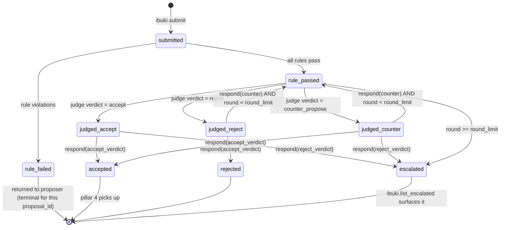

# Pillar 3 — Proposal Workflow Engine

Locked design for the proposal evaluation engine — the heart of ibuki. When a human or remote agent submits a change request via `ibuki.submit`, the engine validates it deterministically (schema + uniqueness + conflict), asks an LLM judge for a verdict, returns **accept** / **reject** / **counter-propose**, and supports iterative proposer responses until convergence or escalation.

Sourced from [issue #9](https://github.com/weyucou/ibuki/issues/9) and the 2026-05-20 architecture re-scope, then grounded against `weyucou/ibuki-backend@main` (apps, models, MCP tools).

## Status

| Item | State |
|---|---|
| [DECISION A — Postgres (RDS) via Django ORM](https://github.com/weyucou/ibuki/issues/8#issuecomment-4495898016) | locked (shared with pillar 2) |
| [DECISION C — Normalised set-intersection conflict semantics](https://github.com/weyucou/ibuki/issues/9#issuecomment-4495898391) | locked |
| [DECISION D — Single judge attempt + one 5xx-only auto-retry](https://github.com/weyucou/ibuki/issues/9#issuecomment-4495898571) | locked |
| Pillar-1 schema validator location (delegate target for the schema rule) | open — resolve before child 2 (see [Open items](#open-items)) |
| `scope_in_normalised` generated-column pattern (`GeneratedField` vs raw SQL) | open — child 1 author's call |
| INSERT-only Postgres role ownership (migration vs infra) | open — child 1 vs `ibuki-infra` |

Design (state machine, rule semantics, judge contract, escalation) is **locked**; the open items are implementation-detail choices that do not change the contract below.

## What this pillar delivers

The engine satisfies the eight EARS acceptance criteria in [issue #9](https://github.com/weyucou/ibuki/issues/9). In brief:

- Rule checks (schema + uniqueness + conflict) **always** run before the LLM judge; a rule failure short-circuits and the judge is **never** invoked.
- On rule pass the judge returns `accept` | `reject` | `counter_propose`; a `counter_propose` carries a revised draft proposal plus reasoning.
- The proposer iterates via `ibuki.respond(proposal_id, action, payload)` (`accept_verdict` | `reject_verdict` | `counter`).
- Iteration is bounded (`round_limit`, default `5`); on exhaustion the proposal is auto-escalated (`state='escalated'`) to a human reviewer.
- Conflict detection flags overlapping proposals touching the same `scope.in` area within the tenant.
- All rule checks are scoped to the calling tenant's specs only — the tenant is resolved from `mcp_server.context.current_tenant()`, never client-supplied.

## Architecture decisions

| Concern | Decision | Rationale |
|---|---|---|
| Module home | `backend/proposals/` Django app in `weyucou/ibuki-backend` | Repo roots the Django project at `backend/` with apps as top-level packages (`tenants`, `specs`, `mcp_server`, …); the new app sits alongside them |
| Rule engine shape | Pure functions `rule(proposal, tenant_specs) -> RuleResult`, run in one pass by an orchestrator | Trivially unit-testable; no I/O; all violations collected so the proposer fixes everything in one revision |
| LLM provider | **Anthropic** via the official `anthropic` Python SDK | Claude-first per README; key already in pillar 2 Secrets Manager (`ibuki/anthropic_api_key`) |
| LLM model | Default `claude-sonnet-4-6`; per-tenant + env override, opt-up to `claude-opus-4-8` | Sonnet 4.6 is the cost/latency sweet spot; complex cases can opt up |
| LLM call pattern | Single-call structured output (tool-use / JSON) → `JudgeVerdict` | Avoids prompt-injection round-trips; one cache-able system prompt per schema version |
| Persistence — proposals | Django ORM `Proposal` on Postgres (same RDS as pillar 2) | Consistent stack; relational conflict query via GIN index |
| Persistence — audit log | Django ORM `ProposalEvent`; append-only enforced by `(proposal, event_seq)` unique constraint + INSERT-only Postgres role | Immutable audit trail |
| Conflict detection | GIN index on generated `scope_in_normalised text[]`; `&&` overlap operator | O(log n); normalisation in a Python helper **and** a Postgres `IMMUTABLE` function (byte-for-byte identical) |
| Uniqueness / supersedes | Postgres recursive CTE, depth cap = 10 | DB enforces the graph traversal + cycle detection; replaces DFS-in-Python |
| State machine | Explicit `State` enum + transition table; rejected transitions raise `IllegalTransitionError` | Mechanical, one file, property-testable |
| Iteration bound | `round_limit` setting (`IBUKI_ROUND_LIMIT`, default `5`); per-tenant override on the `tenants.Tenant` row | Cheap to change without redeploy |
| MCP tool dispatch | New tools added to the existing `backend/mcp_server/tools.py` and registered in `build_mcp()`; ORM-touching tools MUST be **async** (`acreate`/`afirst`/`sync_to_async`) | FastMCP runs sync tools in the event loop — a bare sync ORM call raises `SynchronousOnlyOperation` (per the existing `get_spec` stub) |
| Tenant scoping | FK → `tenants.Tenant`; tenant from `mcp_server.context.current_tenant()`, never client-supplied | Reuses pillar 2's isolation chokepoint; there is **no `Project` model** |
| Escalation surface | New MCP tool `ibuki.list_escalated` over `state='escalated'` | No UI in v1; an admin agent pulls the queue |
| Concurrency | Optimistic lock `version` on `Proposal`: `UPDATE … SET version=version+1 WHERE version=$expected` → 0 rows raises `OptimisticLockError` | Two agents responding simultaneously cannot both win |
| Idempotency | `respond(…, client_request_id)`; a duplicate `client_request_id` returns the prior result | Safe retries from remote agents |
| LLM judge retry | Single attempt, 30 s timeout; **one auto-retry on HTTP 5xx only** (not on timeouts); on failure return `judge_unavailable` (state stays `rule_passed`) | Handles transient Anthropic outages without a proposer round-trip; audit log captures both attempts |

## Data model (Django ORM, abridged)

`backend/proposals/models.py`

- `Proposal(tenant [FK→tenants.Tenant], supersedes [self-FK, nullable], schema_version, feature_id, payload [jsonb], state, round, round_limit, version [optimistic lock], scope_in_normalised [generated text[]], created_at, updated_at)`
  - `state` choices: `submitted` | `rule_failed` | `rule_passed` | `judged_accept` | `judged_reject` | `judged_counter` | `accepted` | `rejected` | `escalated`
  - `supersedes` is the graph edge (`supersedes_id`) consumed by the uniqueness recursive CTE
  - `scope_in_normalised` is derived from `payload->'scope'->'in'` by a Postgres `IMMUTABLE` function
  - Indexes: `(tenant, state)` — conflict query + escalation queue; **GIN** on `scope_in_normalised` — `&&` overlap
- `ProposalEvent(proposal [FK], event_seq [int], round, event_type, actor [FK→User, nullable], payload [jsonb], created_at)`
  - `event_type`: `submitted` | `rule_check` | `judge_verdict` | `respond` | `escalate`
  - Append-only: `unique_together = (proposal, event_seq)` at the DB layer + INSERT-only Postgres role (revoke UPDATE/DELETE on `proposals_proposalevent` for the app role)

The proposal `payload` carries the full pillar-1 schema body (`schema/v0.1.0/proposal.schema.json`), including its `project` string and payload-level `supersedes` feature_id; the model FK is to `tenants.Tenant` because the backend has no `Project` model.

## State machine



Locks live after `accepted`; an accepted proposal is what pillar 4 (release management) queues.

## Rule engine

All three rules run in one pass; the engine collects every violation and returns them together.

1. **Schema rule** — delegates to the pillar-1 validator (`ibuki.schema.validate`); failure returns the JSON Schema error list verbatim. (Validator location is an [open item](#open-items).)
2. **Uniqueness rule** — Postgres recursive CTE over the supersedes graph, depth cap = 10:
   ```sql
   WITH RECURSIVE chain AS (
     SELECT id, supersedes_id, 1 AS depth FROM proposals_proposal WHERE id = %s
     UNION ALL
     SELECT p.id, p.supersedes_id, c.depth + 1 FROM proposals_proposal p
     JOIN chain c ON p.id = c.supersedes_id
     WHERE c.depth < 10
   )
   SELECT id FROM chain WHERE id = %s;
   ```
   - Existing accepted/open row with same `feature_id` not listed in `supersedes` → `duplicate_feature_id`
   - `supersedes` references a non-existent / non-accepted `feature_id` → `invalid_supersedes`
   - Cycle detected → `supersedes_cycle`
3. **Conflict rule** — single GIN-indexed query, scoped to the tenant:
   ```sql
   SELECT id FROM proposals_proposal
   WHERE tenant_id = %s
     AND state IN ('submitted','rule_passed','judged_accept','judged_reject','judged_counter','accepted')
     AND scope_in_normalised && %s::text[];
   ```
   Non-empty result → `scope_overlap` violation naming the offending `proposal_id`s.

### Scope normalisation (Decision C)

`lower().strip()`, replace `\` with `/`, collapse repeated `/`, strip trailing `/`. Any shared element between two proposals' normalised `scope.in` arrays triggers `scope_overlap`. Implemented as `proposals.scope.normalise()` in Python **and** as a Postgres `IMMUTABLE` SQL function driving the generated column — both must agree byte-for-byte (a consistency test is required). Ancestor/path-prefix matching and Jaccard thresholds were considered and rejected for v1.

## LLM judge contract

System prompt is pinned and versioned in `backend/proposals/judge/prompts/judge_v1.md` (ibuki vision, schema, the three verdicts, structured-output shape). The user message carries the validated proposal, a trimmed catalogue of related locked specs (same `scope.in` family, capped at 20, oldest summarised), and the prior rounds of dialogue for this `proposal_id`.

Response is constrained to:

```python
class JudgeVerdict(BaseModel):
    verdict: Literal["accept", "reject", "counter_propose"]
    reasoning: str                     # 1–3 paragraphs
    counter_proposal: Proposal | None  # required iff verdict == "counter_propose"
    confidence: float                  # 0.0–1.0
```

Invocation (Decision D): single attempt, 30 s timeout; **one retry on HTTP 5xx only** (not on timeouts); on failure return `None` → caller writes a `judge_unavailable` event and the state stays `rule_passed`. `confidence < 0.5` is logged at WARNING but does not change the verdict.

```python
def invoke_judge(prompt: str) -> JudgeVerdict | None:
    try:
        return _call_anthropic(prompt, timeout_s=30)
    except AnthropicHTTPStatus5xx:
        try:
            return _call_anthropic(prompt, timeout_s=30)  # one 5xx retry only
        except (AnthropicHTTPStatus5xx, TimeoutError):
            return None
    except TimeoutError:
        return None  # no retry on timeout
```

A 5xx-then-success writes two `judge_invoked` events (`outcome=5xx`, then `outcome=ok`); a 5xx-then-5xx writes two `judge_invoked` events plus one `escalated` (`reason=judge_unavailable`) — keeping the audit honest so ops can tell a transient blip from a real outage.

## Logging contract

Every engine action emits one INFO log per the [Logging Standard](https://github.com/weyucou/sops/blob/main/standards/logging.md). Payloads are never logged — only counts and types.

| Event | Required extra fields |
|---|---|
| `proposal.submitted` | `proposal_id`, `feature_id`, `round` |
| `proposal.rule_check` | `proposal_id`, `rules_passed`, `violations` (count + types) |
| `proposal.judge_invoked` | `proposal_id`, `model`, `prompt_version`, `latency_ms`, `outcome` |
| `proposal.responded` | `proposal_id`, `action`, `round`, `client_request_id` |
| `proposal.escalated` | `proposal_id`, `reason` (`round_limit` \| `reject_after_accept` \| `judge_unavailable`) |

## Module layout (additive to pillar 2)

```
weyucou/ibuki-backend/
└── backend/
    ├── proposals/                     # NEW Django app
    │   ├── apps.py
    │   ├── models.py                  # Proposal + ProposalEvent
    │   ├── migrations/
    │   ├── states.py                  # State enum + transition table
    │   ├── scope.py                   # normalise() — matches the Postgres IMMUTABLE function
    │   ├── rules/
    │   │   ├── __init__.py            # run_rules(proposal, tenant) -> list[Violation]
    │   │   ├── schema_rule.py         # delegates to the pillar-1 schema validator
    │   │   ├── uniqueness_rule.py     # feature_id + supersedes recursive CTE
    │   │   └── conflict_rule.py       # scope GIN overlap query
    │   ├── judge/
    │   │   ├── client.py              # Anthropic wrapper; 30 s timeout, one 5xx retry
    │   │   ├── prompts/judge_v1.md    # versioned system prompt
    │   │   └── schema.py              # JudgeVerdict pydantic model
    │   ├── engine.py                  # orchestrator: submit(), respond()
    │   ├── escalation.py              # round-bound enforcement + escalate() transition
    │   └── admin.py                   # read-only Django admin for escalated proposals
    └── mcp_server/
        └── tools.py                   # EXISTING — swap the `submit` stub for the real engine;
                                       #   add async `respond` + `list_escalated`, register in build_mcp()
```

There is no `ibuki/server/tools/` package: the five MCP tools are functions in a single `backend/mcp_server/tools.py`.

## Child issue split

The epic stays in `weyucou/ibuki`; the four children land in `weyucou/ibuki-backend` and take the next free numbers (the repo's last issue was **#8**; child 1 landed as [ibuki-backend#10](https://github.com/weyucou/ibuki-backend/issues/10)). All four share the DoD: gitleaks, ruff, pyright, pytest, security checklist.

1. **Workflow data model & state machine** (`complexity:medium`) — `Proposal` (incl. `tenant` + `supersedes` FKs) + `ProposalEvent` models, migrations (GIN index + generated column + INSERT-only role), transition table + property tests, append-only DB enforcement test. **Critical-path prerequisite for 2–4.** Filed as [ibuki-backend#10](https://github.com/weyucou/ibuki-backend/issues/10).
2. **Rule engine (schema + uniqueness + conflict)** (`complexity:medium`) — pure-function rules, scope-normalisation Python/Postgres consistency test, supersedes recursive CTE (depth cap = 10). *Depends on child 1 + the pillar-1 schema validator.*
3. **LLM judge** (`complexity:medium`) — add the `anthropic` SDK, Anthropic client wrapper, versioned prompt, structured-output schema, 30 s timeout + one 5xx retry, stub-based tests.
4. **MCP wiring + docs** (`complexity:medium`) — swap the `submit` stub, add async `respond` + `list_escalated` in `mcp_server/tools.py` (registered in `build_mcp()`); `docs/proposal-workflow.md` with a sequence diagram; two-tenant integration tests.

Children 2 and 3 can run in parallel once child 1's models exist; child 4 wires them in.

## Testing strategy

| Layer | Tool | Coverage |
|---|---|---|
| State machine | `pytest` + `hypothesis` | Every `(state, event)` is in the transition table or raises `IllegalTransitionError`; no orphan states |
| Rule engine | `pytest` | Per-rule pass/fail; multi-violation accumulation; uniqueness cycle detection |
| Conflict rule | `pytest` + `hypothesis` | Normalisation idempotent; intersection commutative; Python and Postgres normalise identically |
| Judge client | `pytest` + stub `anthropic` | Schema-constrained output; timeout path; `judge_unavailable`; 5xx retry path |
| Engine integration | `pytest` + `pytest-django` (`--keepdb`) | Happy path; `rule_failed` short-circuits (judge stub asserts un-called); counter loop; escalation on round bound |
| Audit log | `pytest` | Duplicate `(proposal, event_seq)` raises `IntegrityError`; INSERT-only role rejects UPDATE |
| Tenant isolation | `pytest` | Tenant A's submit cannot see Tenant B's proposals during conflict / uniqueness checks |
| Logging | `pytest` capsys + structlog test renderer | All required fields present; no payload PII in `judge_invoked` logs |

LLM calls in CI use a stub fixture — no real Anthropic calls. A nightly job against the real API is gated on `IBUKI_LIVE_LLM_TESTS=1`.

## Out of scope (v1)

- Custom per-tenant rules (deferred per [#6](https://github.com/weyucou/ibuki/issues/6); v1 ships the three built-in rule families)
- Human reviewer UI for escalated proposals (surfaced as the `ibuki.list_escalated` MCP tool / queue)
- Multi-LLM voting / ensembles (single judge in v1)
- Live LLM tests in default CI (gated nightly, opt-in via `IBUKI_LIVE_LLM_TESTS=1`)
- Auto-retry on `judge_unavailable` beyond the one 5xx retry (proposer-driven retry only)

## Open items

Grounded against `ibuki-backend@main`; resolve before/within the child issues named:

1. **Pillar-1 schema validator location** (gates child 2) — the schema rule delegates to the pillar-1 validator, but `backend/specs/models.py` is still a stub and there is no schema-validation module or `jsonschema` dependency in the repo. Decide build-in-repo vs separate package before child 2 opens; raise a `needs:decision` if the answer isn't obvious.
2. **`scope_in_normalised` generated column** (child 1) — Django 5.x `GeneratedField` needs a DB function expression; no precedent for generated columns exists in current migrations. Child 1 author picks raw SQL vs a `Func` node referencing the `IMMUTABLE` function.
3. **INSERT-only Postgres role** (child 1 vs infra) — revoking UPDATE/DELETE on `proposals_proposalevent` is a DB grant, not a model concern. Decide owner: a `RunSQL` migration in child 1 vs an infra step in `ibuki-backend#4` (AWS deploy) / `ibuki-infra`.
4. **`anthropic` dependency** (child 3) — not yet in `pyproject.toml`; child 3 adds it.
5. **`claude-opus-4-8` opt-up model** (child 3) — confirmed as the current Opus model ID for the per-tenant high-complexity override; default remains `claude-sonnet-4-6`.
